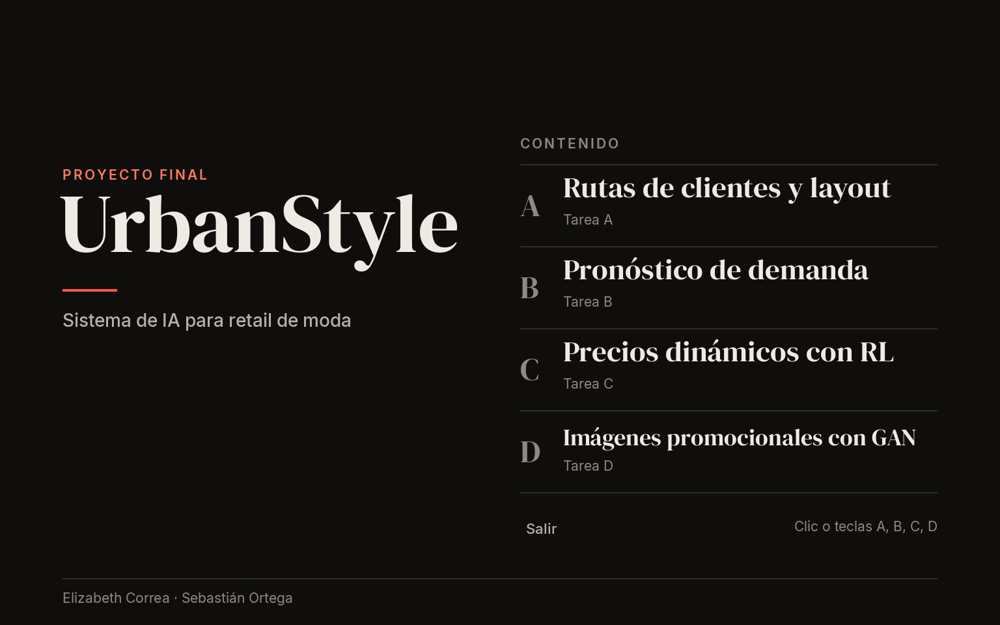
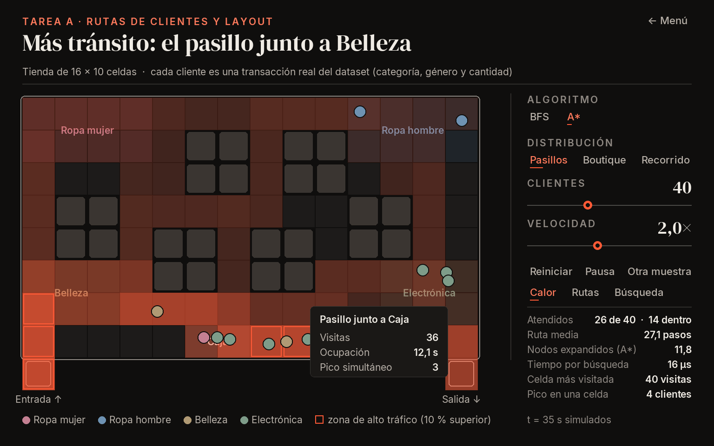
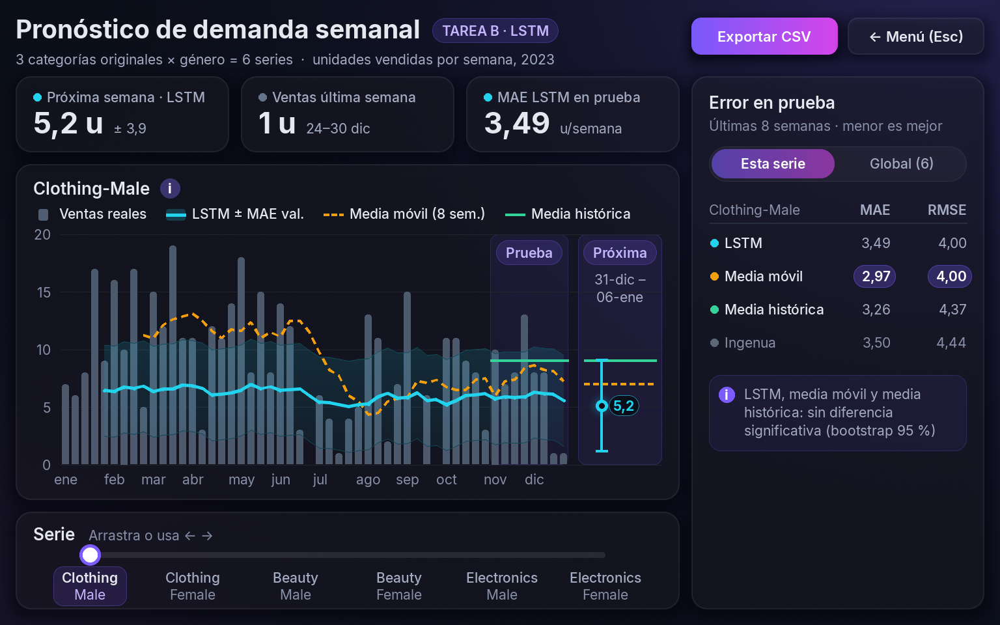
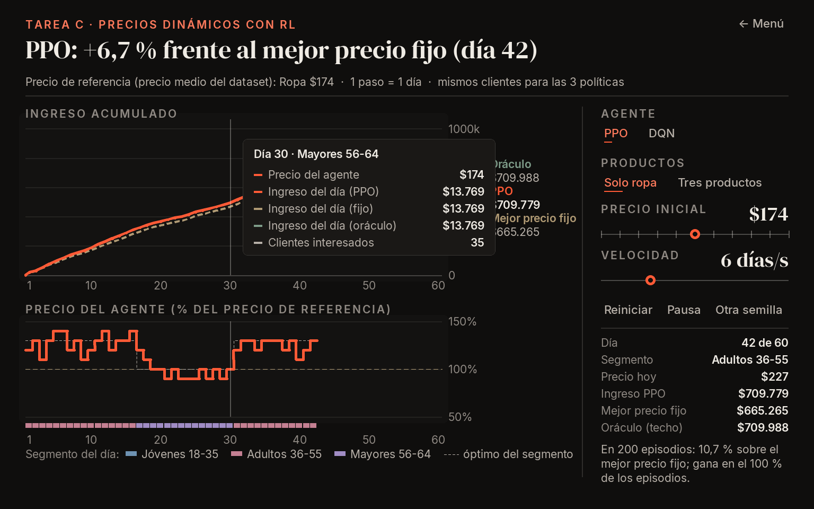
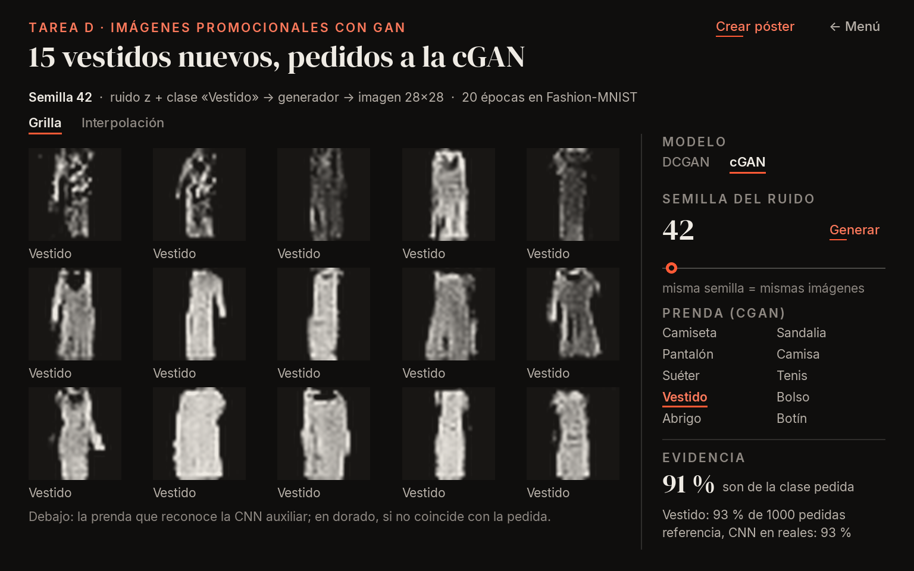

<div align="center">

# UrbanStyle

**Sistema de IA para retail de moda**

Proyecto final · AIDA_M · Escuela Colombiana de Ingeniería<br>
Elizabeth Correa · Sebastián Ortega

[](https://www.python.org/)
[](https://pytorch.org/)
[](https://www.pygame.org/)
[](https://gymnasium.farama.org/)
[](https://stable-baselines3.readthedocs.io/)

</div>

<p align="center">
  
</p>

UrbanStyle es una aplicación de escritorio (Pygame) que reúne cuatro soluciones de IA para una tienda de moda. Desde un solo menú se exploran las rutas de los clientes en la tienda, el pronóstico de la demanda, los precios dinámicos y la generación de imágenes promocionales. Todo parte de datos reales: el Retail Sales Dataset (1 000 transacciones de 2023) y Fashion-MNIST.

---

## Inicio rápido

**1. Crear el entorno e instalar**

```bash
python -m venv .venv
# Windows
.venv\Scripts\activate
# Linux / macOS
source .venv/bin/activate

pip install -r requirements.txt
```

**2. Abrir la aplicación**

```bash
python main.py
```

**3. Ejecutar las pruebas**

```bash
pytest
```

> **Los modelos ya entrenados están en `models/`: no hace falta entrenar nada para usar la app. Funciona en CPU.**
>
> Las pruebas tampoco necesitan el CSV, GPU ni entrenamiento.

---

## Las cuatro tareas

| Tarea | Problema del negocio | Técnica | Resultado clave | Bonus |
|---|---|---|---|---|
| **A** · Rutas y layout | ¿Por dónde caminan los clientes y dónde se congestiona la tienda? | BFS y A* sobre una grilla | A* encuentra rutas igual de cortas expandiendo entre el 23 % y el 55 % de los nodos de BFS | ✓ 3 distribuciones comparadas |
| **B** · Pronóstico de demanda | ¿Cuántas unidades se venderán la próxima semana? | LSTM (PyTorch) | MAE 3,40 y RMSE 4,12 unidades/semana; supera con claridad a la línea base ingenua | ✓ Comparación con líneas base<br>✓ Exportación a CSV |
| **C** · Precios dinámicos | ¿Qué precio cobrar cada día para maximizar el ingreso? | Aprendizaje por refuerzo: DQN y PPO (Gymnasium + stable-baselines3) | DQN +11,9 % y PPO +10,7 % de ingreso sobre el mejor precio fijo | ✓ Tres productos a la vez |
| **D** · Imágenes promocionales | ¿Cómo crear imágenes nuevas de prendas para campañas? | DCGAN y GAN condicional (PyTorch) | DCGAN cubre las 10 clases; el 90,9 % de las imágenes de la cGAN es de la prenda pedida | ✓ cGAN<br>✓ Póster promocional |

---

## Controles de la app

| Dónde | Control | Acción |
|---|---|---|
| Menú | `A` `B` `C` `D` o clic | Abre la tarea |
| Cualquier pantalla | `Esc` o «← Menú» | Vuelve al menú |
| Tareas A y C | `Espacio` | Pausa / reanuda la simulación |
| Tarea B | `←` `→` | Cambia de serie |
| Tarea D | `←` `→` · `↑` `↓` · `G` · `P` | Cambia la semilla · cambia la prenda (cGAN) · genera · crea el póster |

Qué se puede hacer en cada pantalla:

- **A:** elegir algoritmo (BFS / A*) y distribución, ajustar clientes y velocidad, y ver las capas Calor, Rutas y Búsqueda. Al pasar el mouse sobre una celda se ven sus visitas y su ocupación.
- **B:** elegir una de las 6 series, comparar ventas reales con el pronóstico y las líneas base, ver el error en prueba y la próxima semana, y exportar a CSV.
- **C:** ver en vivo el ingreso acumulado del agente frente al mejor precio fijo y al oráculo. Se elige el agente (PPO / DQN), uno o tres productos, el precio inicial y la velocidad.
- **D:** generar prendas con la DCGAN o pedir una prenda a la cGAN, cambiar la semilla, ver la interpolación animada y crear un póster.

---

## Tarea A — Rutas de clientes y layout (BFS y A*)

<p align="center">
  
</p>

La tienda es una grilla de 16 × 10 celdas con 4 secciones (Ropa mujer, Ropa hombre, Belleza y Electrónica), una caja, una entrada y una salida. Cada cliente es una **transacción real** del dataset: entra, va a la sección de su compra, paga y sale. Cada tramo se planea con **BFS o A\*** (heurística Manhattan). Se cuentan las visitas por celda para encontrar las zonas de alto tráfico y se comparan **3 distribuciones**: Pasillos, Boutique y Recorrido.

**Resultados** (`outputs/task_a/metrics/`)

- **Rutas óptimas en ambos:** en los 2 976 pares origen-destino, BFS y A* dan rutas del mismo largo el 100 % de las veces.
- **Eficiencia:** A* expande entre el 23 % (Boutique) y el 55 % (Recorrido) de los nodos de BFS. Expande menos nodos en más del 97 % de los pares y nunca más.
- **Congestión:** en las 3 distribuciones, el punto más congestionado es el pasillo entre la caja y la salida.

<details>
<summary><b>Reproducir y archivos</b></summary>

No hay modelo que entrenar.

```bash
python -m task_a_pathfinding.evaluate   # BFS vs. A* en todos los pares y experimento de layouts (~6 s) -> outputs/task_a/
python main.py                          # menú -> "Tarea A"
```

| Archivo | Qué hace |
|---|---|
| `task_a_pathfinding/store.py` | Grilla (grafo implícito), secciones, los 3 layouts y su validación (todas las secciones alcanzables) |
| `task_a_pathfinding/search.py` | BFS y A*, con nodos expandidos, tiempo y orden de exploración; `None` si no hay ruta |
| `task_a_pathfinding/simulation.py` | Clientes del dataset que recorren la tienda; visitas, ocupación y pico por celda; independiente de los FPS |
| `task_a_pathfinding/evaluate.py` | Comparación BFS vs. A* en las mismas condiciones y experimento de layouts |
| `task_a_pathfinding/screen.py` | Pantalla: algoritmo, layout, sliders de clientes y velocidad, capas Calor / Rutas / Búsqueda, tooltip por celda |

Descripción de cada salida: [`outputs/task_a/README.md`](outputs/task_a/README.md).

</details>

---

## Tarea B — Pronóstico de demanda (LSTM)

<p align="center">
  
</p>

El dataset tiene 3 categorías (Beauty, Clothing, Electronics). Al cruzarlas con el género del cliente se obtienen **6 series** (por ejemplo, `Clothing-Female`); este desglose se hizo con autorización del profesor. Cada serie son las unidades vendidas por semana: 52 semanas completas, divididas en orden cronológico en 36 de entrenamiento, 8 de validación y 8 de prueba. Una **LSTM** predice la semana siguiente y se compara con tres líneas base en las mismas semanas de prueba.

**Resultados** (`outputs/task_b/metrics/`, 48 semanas-serie de prueba)

| Modelo | MAE | RMSE |
|---|---|---|
| **LSTM** | **3,40** | **4,12** |
| Media móvil (k = 8) | 3,34 | 4,32 |
| Media histórica (train + val) | 3,24 | 4,08 |
| Ingenua (semana anterior) | 4,79 | 5,58 |

- **Frente a la ingenua:** la LSTM es claramente mejor. El intervalo bootstrap del 95 % de la diferencia en MAE es [+0,56, +2,23] y no toca el 0.
- **Frente a los promedios:** LSTM, media móvil y media histórica empatan (sin diferencia significativa). Las series son ruido alrededor de un nivel estable, así que no hay dinámica temporal que la LSTM pueda explotar.
- **Piso de error:** incluso un oráculo que conociera el nivel real de prueba lograría MAE 3,15. La LSTM queda a 0,25 unidades de ese límite.

<details>
<summary><b>Reproducir y archivos</b></summary>

El modelo final ya está en `models/lstm_forecast.pt`. Desde la raíz:

```bash
python -m task_b_forecasting.eda                 # análisis exploratorio -> outputs/task_b/eda/
python -m task_b_forecasting.tune                # (opcional, ~4,5 min) comparación de modelos con validación
python -m task_b_forecasting.train               # entrena las 6 LSTM (~3 s en CPU) -> models/lstm_forecast.pt
python -m task_b_forecasting.evaluate            # evalúa el modelo guardado: métricas, gráficas, próxima semana y CSV
python -m task_b_forecasting.evaluate --seeds 5  # lo mismo, y reentrena con 5 semillas para medir la variabilidad
python -m task_b_forecasting.retrain_check       # (opcional, ~15 s) backtest: ¿reentrenar con train+val?
python main.py                                   # menú -> "Tarea B"
```

| Archivo | Qué hace |
|---|---|
| `common/data.py` | Carga y valida el CSV, crea las series y la tabla semanal |
| `task_b_forecasting/prepare.py` | Split cronológico 36/8/8 semanas, MinMax ajustado solo con train, ventanas deslizantes |
| `task_b_forecasting/baselines.py` | MAE, RMSE y líneas base: ingenua, media móvil (k elegido con validación) y media histórica |
| `task_b_forecasting/model.py` | LSTM + capa lineal; guardar y cargar el checkpoint |
| `task_b_forecasting/train.py` | Entrenamiento (Adam, MSE, dropout, early stopping, semilla fija) |
| `task_b_forecasting/tune.py` | Modelo por serie vs. compartido y elección de hiperparámetros con validación |
| `task_b_forecasting/evaluate.py` | LSTM vs. líneas base en las mismas semanas de prueba; sesgo, bootstrap y `predictions.csv` |
| `task_b_forecasting/retrain_check.py` | Backtest sin tocar prueba para decidir si reentrenar con train+val |
| `task_b_forecasting/screen.py` | Pantalla: selector de serie, gráfica real vs. predicho, métricas, próxima semana, Exportar CSV |

Descripción de cada salida: [`outputs/task_b/README.md`](outputs/task_b/README.md).

</details>

---

## Tarea C — Precios dinámicos con aprendizaje por refuerzo

<p align="center">
  
</p>

Un entorno Gymnasium propio (`PricingEnv`) simula la venta de un producto día a día:

- **paso** = un día;
- **estado** = precio actual, segmento de edad del día y ventas de los últimos 3 días;
- **acciones** = bajar 20 % / 10 %, mantener, subir 10 % / 20 %;
- **recompensa** = ingreso del día.

La demanda sigue un modelo de disposición a pagar. Sus escalas (precio de referencia, segmentos, cantidades) salen del dataset; la reacción al precio es un **supuesto de simulación** declarado en `task_c_pricing/demand.py`. Se entrenan **DQN y PPO** para un producto (Ropa) y **PPO para tres productos**. Todos se comparan con el **mejor precio fijo** en los mismos 200 episodios y con los mismos clientes.

**Resultados** (`outputs/task_c/metrics/summary.json`, 200 episodios de 60 días)

- **Un producto:** DQN **+11,9 %** y PPO **+10,7 %** de ingreso sobre el mejor precio fijo. El techo (oráculo que conoce la demanda real) es +12,4 %. Ambos ganan en el 100 % de los episodios.
- **Tres productos:** PPO **+7,4 %** (techo +8,3 %), también en el 100 % de los episodios.
- **Diferenciación por segmento:** el agente cobra ~0,7× a los jóvenes, ~1,0× a los mayores y ~1,2× a los adultos, cerca del óptimo de cada segmento.

<details>
<summary><b>Reproducir y archivos</b></summary>

Los agentes finales ya están en `models/` (`dqn_pricing.zip`, `ppo_pricing.zip`, `ppo_pricing_multi.zip` y `pricing_config.json`).

```bash
python -m task_c_pricing.train      # check_env + DQN, PPO y PPO multiproducto (~3 min en CPU) -> models/
python -m task_c_pricing.evaluate   # RL vs. mejor precio fijo y oráculo, 200 episodios (~25 s) -> outputs/task_c/
python main.py                      # menú -> "Tarea C"
```

| Archivo | Qué hace |
|---|---|
| `task_c_pricing/demand.py` | Regla de demanda (disposición a pagar), parámetros del dataset y supuestos; se guarda en `models/pricing_config.json` |
| `task_c_pricing/env.py` | Entorno Gymnasium de uno o varios productos (`Discrete(5)` / `MultiDiscrete`) |
| `task_c_pricing/train.py` | Entrena DQN y PPO con stable-baselines3 (semilla 42, `check_env` antes) |
| `task_c_pricing/policies.py` | Precio fijo, agente, oráculo y precio al azar; un episodio completo |
| `task_c_pricing/evaluate.py` | Comparación justa (mismas semillas, IC 95 % bootstrap pareado), precio por segmento, curvas de aprendizaje |
| `task_c_pricing/screen.py` | Pantalla: ingreso acumulado en vivo de agente vs. mejor precio fijo vs. oráculo, precio día a día, controles |

Descripción de cada salida: [`outputs/task_c/README.md`](outputs/task_c/README.md).

</details>

---

## Tarea D — Imágenes promocionales con GAN (DCGAN y cGAN)

<p align="center">
  
</p>

Una **DCGAN** genera prendas nuevas de 28 × 28 píxeles a partir de ruido. Una **GAN condicional (cGAN)** genera la prenda que se le pide (Camiseta, Pantalón, …, Botín). Con la cGAN se compone un **póster promocional** de UrbanStyle que indica que las prendas fueron generadas por IA. Ambas se entrenan con Fashion-MNIST y se evalúan con una CNN auxiliar (91,1 % de exactitud en imágenes reales de prueba), que solo sirve para medir.

**Resultados** (`outputs/task_d/evaluation/summary.json`)

- **DCGAN sin colapso de modos:** cubre las 10 clases, con entre 7,7 % y 13,4 % de las imágenes cada una.
- **Control de la cGAN:** el 90,9 % de las imágenes es de la clase pedida, casi lo mismo que la CNN acierta en imágenes reales (91,1 %).
- **Calidad (FID-CNN, menor es mejor):** cGAN 10,4 y DCGAN 47,9, frente a 639,8 del ruido puro.
- **Sin memorización:** ninguna muestra está más cerca del entrenamiento que el 1 % más cercano de imágenes reales nuevas.

<details>
<summary><b>Reproducir y archivos</b></summary>

Los modelos finales ya están en `models/` (`gan_generator.pt`, `cgan_generator.pt` y la CNN auxiliar `fashion_cnn.pt`). Desde la raíz:

```bash
python -m task_d_gan.data                # grilla de imágenes reales (descarga Fashion-MNIST la primera vez)
python -m task_d_gan.classifier          # CNN auxiliar para evaluar (~1,5 min en CPU)
python -m task_d_gan.train               # entrena DCGAN y cGAN, 20 épocas cada una (~13 min en CPU)
python -m task_d_gan.evaluate            # evalúa los modelos guardados, sin reentrenar (~20 s)
python -m task_d_gan.poster --seed 7     # póster promocional -> outputs/task_d/poster/
python -m task_d_gan.train --explore 30  # (opcional, ~21 min) exploración con la que se eligieron las 20 épocas
python -m task_d_gan.seeds               # (opcional, ~65 min) robustez: DCGAN y cGAN con 5 semillas más
python main.py                           # menú -> "Tarea D"
```

| Archivo | Qué hace |
|---|---|
| `task_d_gan/data.py` | Fashion-MNIST en [-1, 1] (por la Tanh del generador), nombres de las clases en español, grillas |
| `task_d_gan/models.py` | `Generator` y `Discriminator` (DCGAN); `CondGenerator` y `CondDiscriminator` (cGAN); generación determinista por semilla; checkpoints |
| `task_d_gan/train.py` | Entrenamiento alterno (`detach` en el paso de D, pérdida no saturante), ruido fijo, grilla por época, GIF, curvas, D(x)/D(G(z)) y FID-CNN por época |
| `task_d_gan/classifier.py` | CNN pequeña que solo sirve para **evaluar** las GAN |
| `task_d_gan/metrics.py` | FID-CNN, entropía de clases, diversidad por pares y vecino más cercano |
| `task_d_gan/evaluate.py` | Evaluación completa -> `outputs/task_d/evaluation/summary.json` y figuras |
| `task_d_gan/seeds.py` | Robustez entre semillas: reentrena con las semillas 1–5 y compara con el modelo final (semilla 42) |
| `task_d_gan/poster.py` | Póster con prendas generadas por la cGAN y la nota visible «Prendas generadas por IA» |
| `task_d_gan/screen.py` | Pantalla: Generar, semilla, DCGAN/cGAN, prenda, interpolación animada, Crear póster |

Descripción de cada salida: [`outputs/task_d/README.md`](outputs/task_d/README.md).

</details>

---

## Reproducibilidad

- **Semillas fijas:** `SEED = 42` en `common/config.py`; cada script llama a `set_seed()` (random, NumPy y PyTorch).
- **Rutas relativas:** todas las rutas salen de `common/config.py`; no hay rutas absolutas.
- **CPU, sin GPU:** todo se entrenó y se verificó en CPU con Python 3.13.
- **Modelos incluidos:** los pesos finales están en `models/`. La app y las pantallas solo los cargan; nunca entrenan.
- **Datos intactos:** el CSV original (`data/raw/`) nunca se modifica.
- **Pruebas automáticas:** `pytest` corre 112 pruebas (datos, búsqueda, entorno de RL, pronóstico, GAN, menú e interfaz) en unos segundos.

Tiempo aproximado en CPU para reproducir cada tarea desde cero:

| Tarea | Entrenamiento | Evaluación |
|---|---|---|
| A · Rutas | No aplica (no hay modelo) | ~6 s |
| B · Pronóstico | ~3 s (búsqueda opcional de hiperparámetros: ~4,5 min) | segundos |
| C · Precios | ~3 min (DQN, PPO y PPO multiproducto) | ~25 s |
| D · GAN | ~13 min (DCGAN + cGAN) + ~1,5 min (CNN auxiliar) | ~20 s |

---

## Estructura del repositorio

```text
urbanstyle-aida/
├── main.py               # menú principal: abre cada tarea
├── common/               # configuración, carga de datos e interfaz común
├── task_a_pathfinding/   # Tarea A: búsqueda de rutas y simulación de clientes
├── task_b_forecasting/   # Tarea B: pronóstico de demanda con LSTM
├── task_c_pricing/       # Tarea C: entorno de precios y agentes de RL
├── task_d_gan/           # Tarea D: DCGAN, cGAN y póster promocional
├── models/               # modelos finales ya entrenados
├── data/                 # CSV original (raw/) y derivados (processed/)
├── outputs/              # métricas, figuras y capturas de cada tarea
├── assets/fonts/         # tipografías de la interfaz
├── tests/                # pruebas automáticas (pytest)
└── requirements.txt      # dependencias
```

---

## Datos y créditos

- **Retail Sales Dataset** (Kaggle): 1 000 transacciones con fecha, género, edad, categoría, cantidad y precio. <https://www.kaggle.com/datasets/mohammadtalib786/retail-sales-dataset>
- **Fashion-MNIST** (Zalando Research): 70 000 imágenes de prendas de 28 × 28 en 10 clases. `torchvision` lo descarga solo en `data/FashionMNIST/`. <https://github.com/zalandoresearch/fashion-mnist>
- **Tipografías:** [Inter](https://rsms.me/inter/) y [DM Serif Display](https://fonts.google.com/specimen/DM+Serif+Display), ambas con licencia SIL Open Font License; los archivos y sus licencias están en `assets/fonts/`.

---

## Autores

| Tarea | Autor |
|---|---|
| A · Rutas de clientes y layout | Sebastián Ortega |
| B · Pronóstico de demanda | Elizabeth Correa |
| C · Precios dinámicos con RL | Sebastián Ortega |
| D · Imágenes promocionales con GAN | Elizabeth Correa |
| Menú principal y módulos comunes | Elizabeth Correa |
